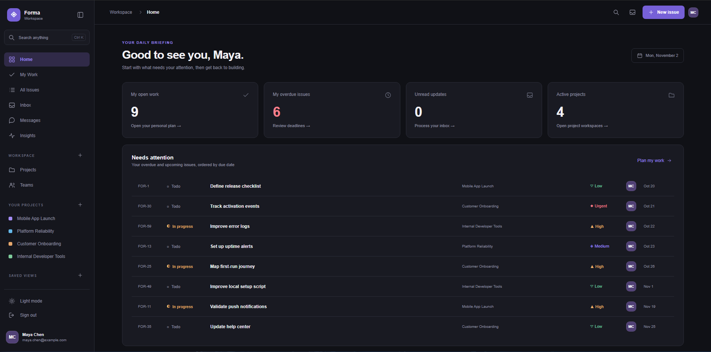
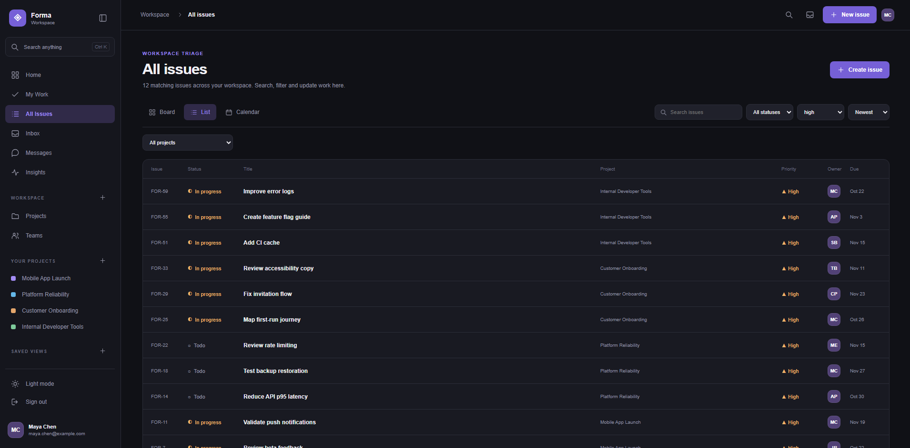
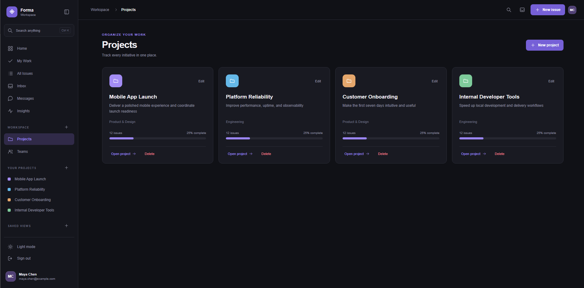
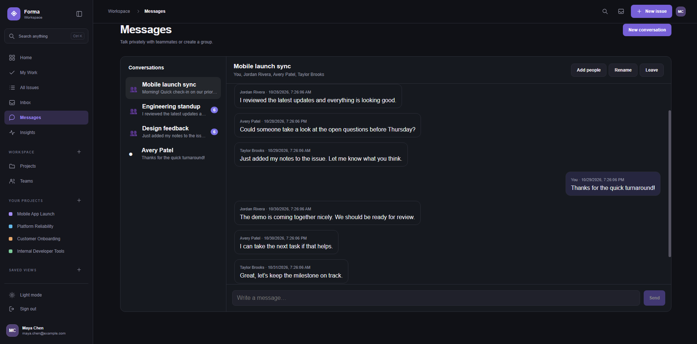
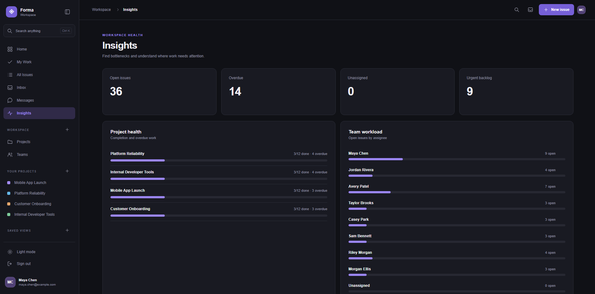
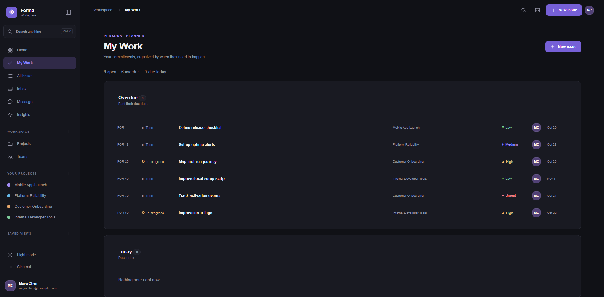
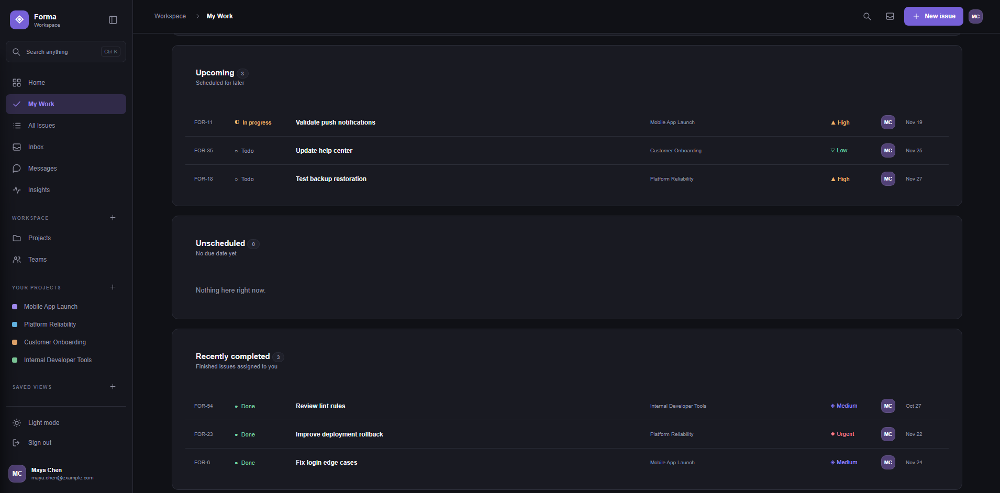
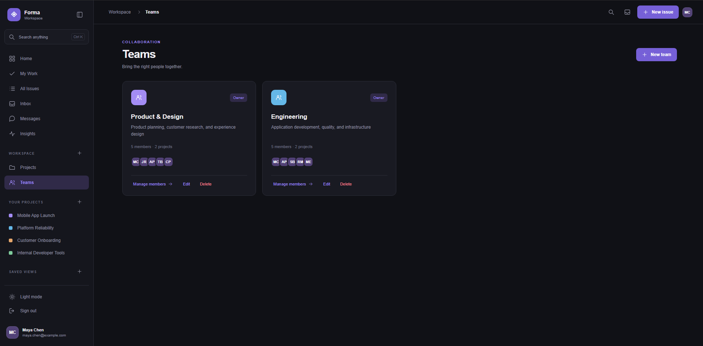

# Forma

**A full-stack workspace for planning projects, managing issues, and collaborating with teams.**

Forma is a project management web application built with **React** and **FastAPI**. It brings together project tracking, personal task planning, team workspaces, messaging, and progress insights in one interface.

> **Status:** Local development project. Screenshots show fictional demo accounts and sample data; a public deployment is not yet available.



## Features

- **Personal dashboard** — see open work, overdue tasks, updates, and active projects.
- **My Work** — review assigned issues grouped by overdue, today, upcoming, and recently completed.
- **Issue management** — browse and filter issues by project, status, and priority; work with list, board, and calendar views.
- **Projects and teams** — organize initiatives, track completion, and manage team members.
- **Messaging** — direct and group conversations with teammates.
- **Insights** — review open issues, overdue work, project health, and workload distribution.
- **Authentication** — user accounts with JWT-based login and password hashing.

## Screenshots

### Issues and priorities

Search, filter, and prioritize work across projects.



### Project overview

Follow project progress and navigate into individual initiatives.



### Team messaging

Communicate through direct and group conversations.



### Workspace insights

Understand overdue work, project health, and team workload.



<details>
<summary><strong>More screenshots — personal planner and teams</strong></summary>

#### My Work — overdue and current tasks


#### My Work — upcoming and completed tasks


#### Teams


</details>

## Tech stack

| Area | Technology |
| --- | --- |
| Frontend | React, JavaScript, Vite, CSS |
| Backend | Python, FastAPI |
| Data access | SQLAlchemy |
| Local database | SQLite |
| Authentication | JWT, password hashing |
| API style | REST |

## Run locally

**Requirements:** Python 3.13, Node.js, npm.

### Backend

From the project root:

```powershell
cd backend
py -3.13 -m venv .venv
.\.venv\Scripts\python.exe -m pip install -r requirements.txt
```

Create `backend/.env` (do not commit this file):

```dotenv
DATABASE_URL=sqlite:///./forma.db
SECRET_KEY=replace-this-with-a-long-random-secret
```

Start the API:

```powershell
.\.venv\Scripts\python.exe -m uvicorn app.main:app --reload
```

API docs: **http://127.0.0.1:8000/docs**

### Frontend

In a second terminal, from the project root:

```powershell
cd frontend
npm install
npm run dev
```

Open **http://localhost:5173** and register an account.

## Architecture

```text
frontend/                 React UI and Vite build setup
  src/
    components/           Feature-specific React components
    App.jsx               Main application shell
backend/
  app/
    main.py               FastAPI routes and application setup
    auth.py               Authentication helpers
    database.py           Database connection and session
    models.py             SQLAlchemy models
    messaging.py          Messaging routes
  requirements.txt
screenshots/              Demo screenshots used in this README
```

The frontend communicates with FastAPI over HTTP. The backend handles authentication, application logic, and persistence using SQLAlchemy.

## About this project

I developed Forma as a hands-on full-stack software engineering project, focusing on connecting a React interface to a Python API, structuring relational application data, and implementing multi-user workflows.

## Next steps

- Deploy a live demo
- Add automated tests and CI
- Expand access controls and validation
- Improve accessibility and responsive layouts

---

Built by [Amir Thompson](https://github.com/amirt2505). Screenshots use fictional demonstration data.
